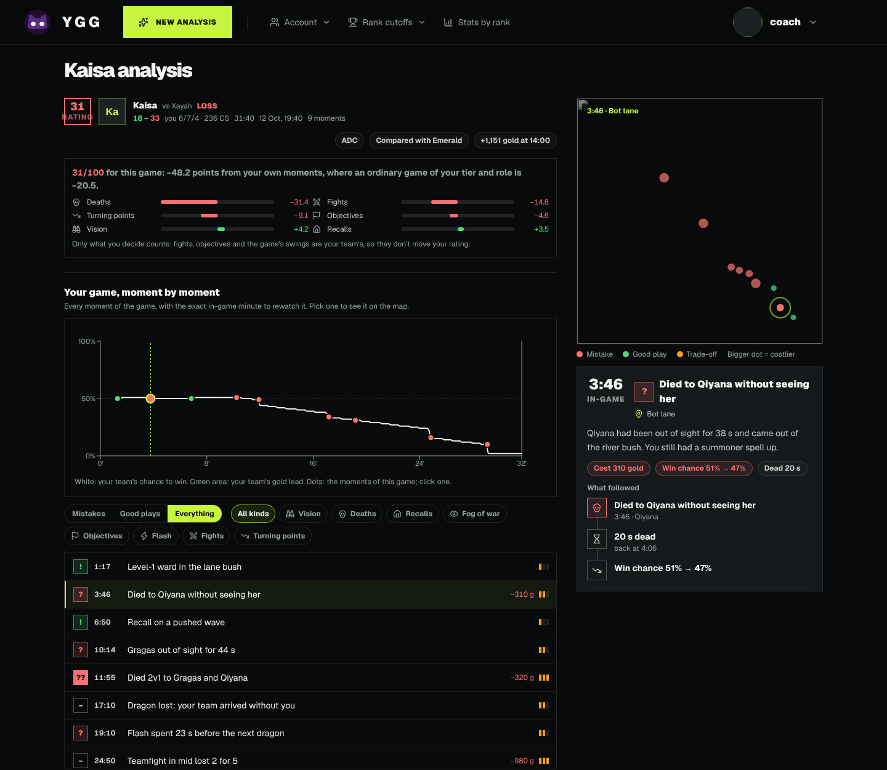
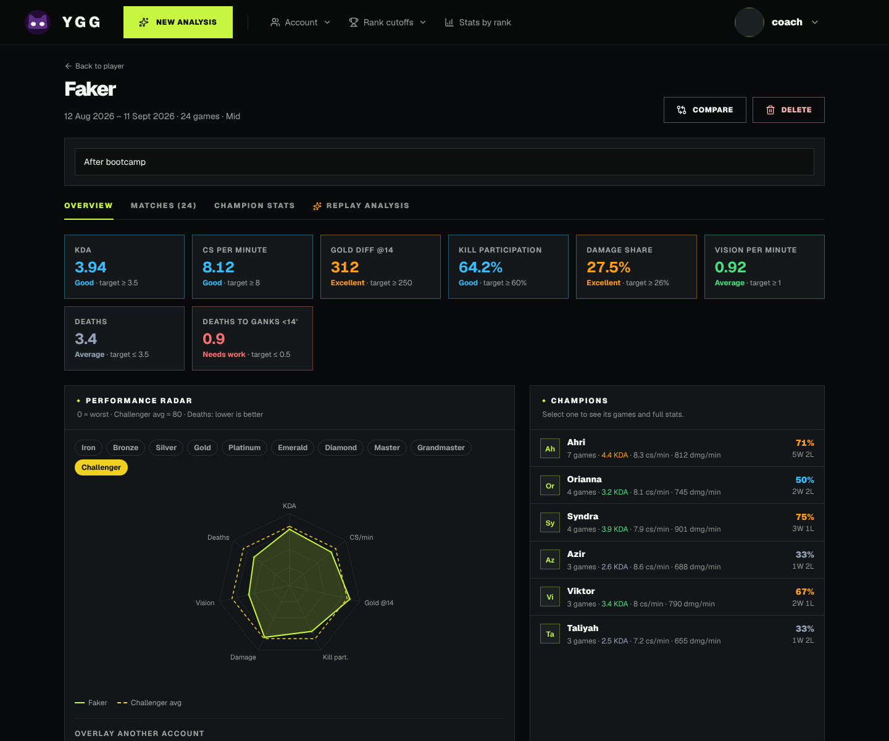
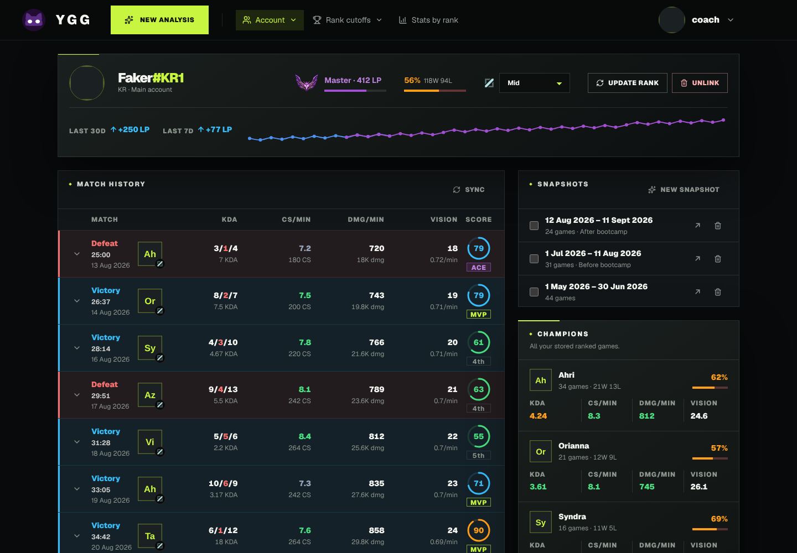
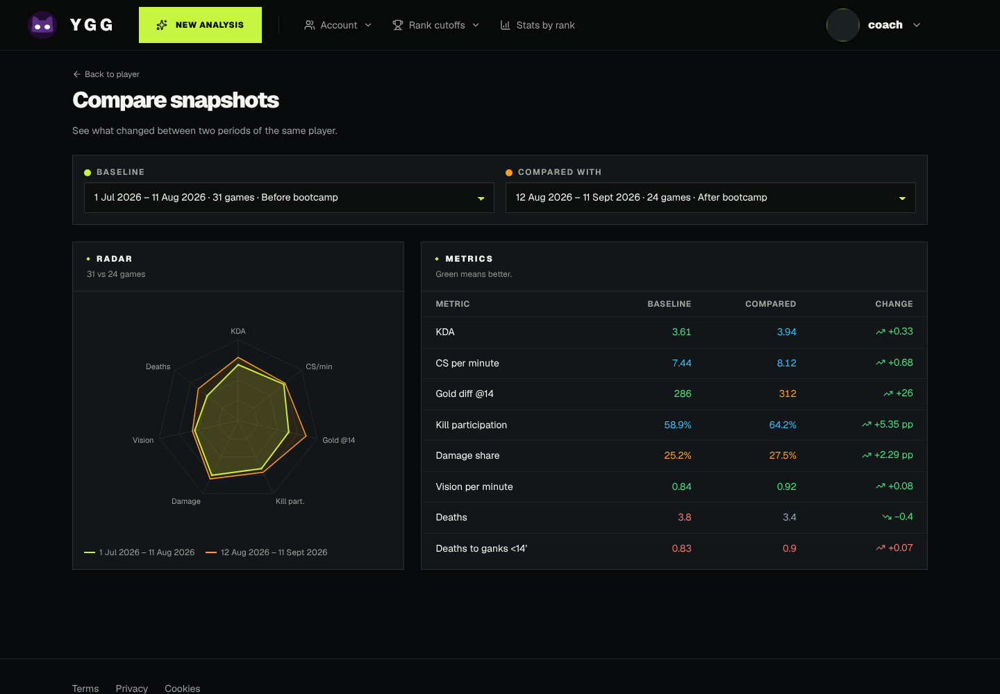
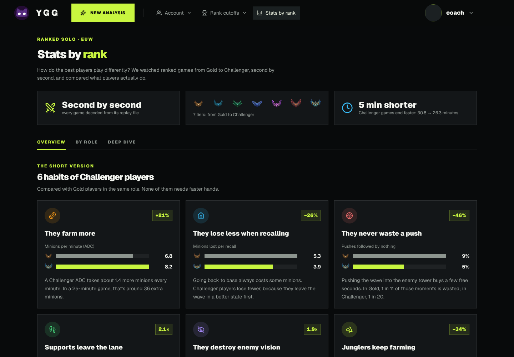
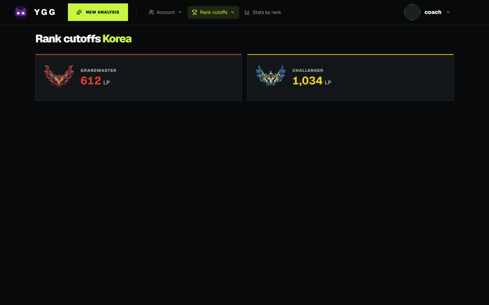
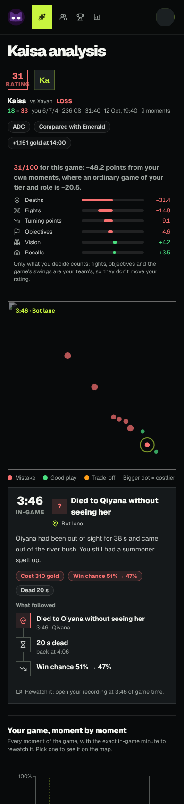
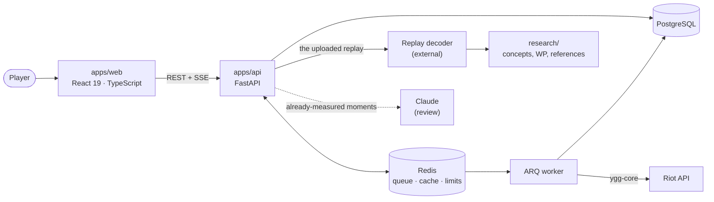

# YGG

**The review a coach would give you, built from the replay of your League of Legends game.**

[](https://github.com/yoangiDev/YGG/actions/workflows/ci.yml)




<sub>Screenshots use synthetic data and a mocked API (see [Screenshots](#screenshots)).</sub>

YGG takes the replay (`.rofl`) of a ranked game, reads it second by second and looks for the moments that decided it:
a death without vision, a Flash spent right before a dragon, a fight lost from the wrong side of the wall. Every moment
comes with its **minute, its place on the map and what it cost**, measured against a win-probability model calibrated
on thousands of games. With that, Claude writes the review in a coach's voice, citing each moment by its id so the web
app can link it to the map and the player can jump to that minute in their own recording.

Around the review there is context: the account's match history, *snapshots* of a period with per-role metrics against
each rank, a comparison between two snapshots, Grandmaster and Challenger LP cutoffs, and stats by rank.

## Project status

A personal project under active development. What works and what doesn't, plainly:

| | |
|---|---|
| **Works and is tested** | User accounts with secure sessions, linking and verifying a Riot account, match history, snapshots with a dashboard, comparison, rank cutoffs, stats by rank, admin panel, a job queue with live progress, a read-only demo mode |
| **Works, with an external dependency** | The **game analysis** needs to decode the `.rofl` with a separate decoder (another project, `lol-replay-decoder`, which needs the game's executables) and the research data. It is not in this repository, so that flow only runs on the author's machine |
| **Doesn't exist yet** | A public deployment and the final legal text |

Without a Riot key or the decoder you can try almost everything with the demo data (see
[Running it locally](#running-it-locally)). The game analysis can be seen in the screenshots and is covered by tests and
by e2e tests with synthetic data.

## What's inside

- **Game analysis from the replay.** The user downloads the `.rofl` from their client and uploads it to the web app. The
  API checks that it is that game and that the user's verified account played it, decodes it in a separate process with
  a deadline and limits, computes the moments and the win-probability curve, and stores the result. The replay is
  deleted when it finishes. Access to this analysis is controlled by a role that the admin assigns.
- **Claude's review.** The model doesn't see the replay and doesn't compute anything: it receives what was already
  measured and writes it up with a fixed JSON schema (headline, summary, lessons with their fix, strengths, a plan for
  the next game). Without an Anthropic key the analysis is stored anyway and the moments stand on their own.
- **Snapshots and dashboard.** Freeze a period of games and look at role metrics coloured by their status, a 0-100
  radar against each rank's average, trends, deaths by phase and a heat map over the minimap.
- **A custom analysis engine** (`ygg-core`): a Riot client with a global rate limiter, timeline enrichment, metrics, a
  DuckDB store and a CLI. It is pure Python, with no FastAPI or database, and is tested on its own.
- **Reproducible research** (`research/`): the ladder harvest, the win-probability model and the per-league, per-role
  reference tables the analysis uses. See [`research/README.md`](research/README.md).

## Screenshots

| Snapshot dashboard | Account: history, snapshots and champions |
|---|---|
|  |  |

| Comparing two snapshots | Stats by rank |
|---|---|
|  |  |

| Rank cutoffs | Mobile |
|---|---|
|  |  |

The screenshot data is synthetic (`apps/web/e2e/fixtures.ts` and `gameAnalysis.ts`) and is served by a mocked API; the
champion, item and map art, which comes from Riot's CDN, is replaced with placeholders. Regenerate them with
`make screenshots` (with network access, `SCREENSHOTS_CDN=1` uses the real art).

## Architecture



| Folder | What it is |
|---|---|
| [`packages/ygg-core`](packages/ygg-core) | Pure-Python analysis engine: Riot client, timeline, metrics, DuckDB, CLI |
| [`apps/api`](apps/api) | Async FastAPI API, ARQ worker, Alembic migrations and replay analysis |
| [`apps/web`](apps/web) | React SPA with an HTTP client generated from the API's OpenAPI contract |
| [`research`](research) | Research: ladder harvest, win-probability model, per-league references |
| [`infra`](infra) | Dockerfiles, docker compose, nginx, Fly.io configuration and a Windows dev script |
| [`docs`](docs) | Architecture, decisions (ADRs), metrics, deployment, design and grading models |

More in [`docs/architecture.md`](docs/architecture.md).

### The interesting parts: why and where

| Topic | Decision | More |
|---|---|---|
| Data | Match and participant stored separately: with two tracked players in the same game, one inherited the other's stats without raising any error | [ADR 0001](docs/adr/0001-match-and-participant.md) |
| Riot API | One sliding-window limiter (1 s and 2 min) with a global pause on a 429, instead of per-request retries | [`rate_limiter.py`](packages/ygg-core/src/ygg_core/riot/rate_limiter.py) |
| Jobs | ARQ with Postgres as the source of truth, a heartbeat and orphan recovery; progress goes over SSE | [ADR 0004](docs/adr/0004-arq-not-celery.md), [0005](docs/adr/0005-sse-not-websockets.md) |
| Session | In-memory access token and a rotated refresh token in an `httpOnly` cookie, not in `localStorage` | [ADR 0006](docs/adr/0006-httponly-cookie-not-localstorage.md) |
| Uploads | A replay is a file from a stranger that ends up in a decoder: session, verified account, own game checked against Riot, rate and size limits (also without `Content-Length`), `.rofl` structure, deadline and deletion | [`routers/games.py`](apps/api/app/routers/games.py) |
| Model | Per-second win probability calibrated on 5,144 EUW games from Gold to Challenger; moments are valued in neutral WP points | [`research/replays/reports/value.md`](research/replays/reports/value.md) |
| Web | HTTP client generated from `openapi.json` (CI fails if they drift), one chunk per screen and a JS budget checked in CI | [`docs/metrics.md`](docs/metrics.md) |

The real problems met along the way are told in [`docs/engineering-notes.md`](docs/engineering-notes.md).

## Quality

Measured in October 2026 (details, and how each figure is measured, in [`docs/metrics.md`](docs/metrics.md)):

| | |
|---|---|
| `ygg-core` tests | **201**, **92%** coverage, strict `mypy` with no errors |
| API tests | **191**, **81%** coverage, against real Postgres and Redis |
| Web unit tests | **111** (Vitest and Testing Library) |
| Web e2e tests | **12** user-flow tests against a mocked API (Playwright), plus 3 against the real API |
| Initial web JS | **125.7 KB** gzip, with a 200 KB budget enforced by CI |
| Migrations | 24 (Alembic is the only owner of the schema) |

GitHub Actions CI runs on every push and pull request: secret detection (gitleaks), `ruff`, `mypy` and the core tests,
the API tests with Postgres and Redis, and on the web side a check that the types match `openapi.json`, lint, tests,
build, the JS budget and the e2e flows.

## Running it locally

Requirements: Docker. Optional: a Riot [development key](https://developer.riotgames.com) to analyse real games.

```bash
RIOT_API_KEY=RGAPI-... docker compose -f infra/docker-compose.yml up -d --build
```

- Web: <http://localhost:5173>
- API and interactive docs: <http://localhost:8000/docs>

Without a Riot key you can explore everything with demo data (the account and the games are synthetic):

```bash
docker compose -f infra/docker-compose.yml exec -e DEMO_PASSWORD=demo-password-123 api python scripts/seed_demo.py
```

and sign in with `demo@ygg.gg` / `demo-password-123`. With `make` installed: `make up`, `make down`, `make logs`.

The API container doesn't include the replay decoder, so **the game analysis doesn't run in Docker**.

### Without Docker

```bash
# Analysis engine
cd packages/ygg-core && pip install -e ".[dev]" && pytest && mypy

# API (needs Postgres; with REDIS_URL=memory:// it uses an in-memory Redis and analyses in-process)
cd apps/api && pip install -e ../../packages/ygg-core -r requirements.txt
cp .env.example .env     # DATABASE_URL, SECRET_KEY, REDIS_URL=memory://
alembic upgrade head && uvicorn main:app --reload

# Web
cd apps/web && npm ci && npm run dev
```

To work with replays, add `pip install -r apps/api/requirements-replays.txt` and point `DECODER_DIR` and
`RESEARCH_DIR` at your paths (see `.env.example`).

### Tests and utilities

| Command | What it does |
|---|---|
| `make test-core` | Engine tests and `mypy`, no services |
| `make test-api` | API tests against the `docker compose` Postgres |
| `make test-web` | Web lint, types, tests, build and JS budget |
| `make e2e` | User flows in the browser against the mocked API |
| `make screenshots` | Regenerates the screenshots in `docs/img` |
| `make lint` | `ruff` and ESLint |

## Repository layout

```
.github/workflows   CI (tests, lint, budget) and manual deployment
apps/
  api/              FastAPI, ARQ worker, migrations, tests and maintenance scripts
  web/              React SPA: src/{app,components,features,lib}, e2e/ and build scripts
packages/
  ygg-core/         analysis engine: riot/ timeline/ metrics/ store/ ddragon/ domain/
research/
  ladder/           ladder harvest and a study of what wins games (WPA)
  replays/          coaching concepts, the value model and the zone and bush map
  coaching/         hand-written reference reviews and their cross-check against the analysis
infra/              Dockerfiles, compose, nginx, Fly.io and dev.ps1
docs/               architecture.md, adr/, metrics.md, deploy.md, design/, model/, history/, img/
```

## Documentation

| Document | What for |
|---|---|
| [`docs/architecture.md`](docs/architecture.md) | Pieces, the flow of an analysis, data, caching and protection |
| [`docs/adr/`](docs/adr/README.md) | Six technical decisions with their alternatives |
| [`docs/engineering-notes.md`](docs/engineering-notes.md) | Four real problems and how they were solved |
| [`docs/metrics.md`](docs/metrics.md) | Every figure, how it was measured and what is still unmeasured |
| [`docs/deploy.md`](docs/deploy.md) | Planned deployment, demo mode and rollback |
| [`docs/design/`](docs/design/) | Visual system and colour guide |
| [`docs/model/`](docs/model/) | How a game's grade and a player's performance are computed |
| [`research/README.md`](research/README.md) | What each script is and how the models are regenerated |

## Still to do

- Deploy a public demo (the configuration is ready; a domain and accounts are missing) and measure Lighthouse and real
  latency.
- Turn the replay decoder into something that can run outside the author's machine, or isolate it behind an interface
  with a test implementation.
- Move the `research/replays` modules that the API loads in production into `ygg-core` or a package of their own.
- Calibrate the coaching concepts that don't score yet; today the engine is calibrated for marksmen (ADC) on EUW.
- Final legal text.

## History

YGG started as a final-year degree project (TFG), with a Flutter client and a FastAPI API. This version is a rewrite
(a monorepo, a corrected data model, a hardened API, jobs outside the process and a React web client) that, after
public replay access was closed in patch 16.20, was turned around: from tracking other people's accounts to analysing
the games of your own account. The plan for each phase is in [`docs/history/`](docs/history/). The original Flutter
client is not part of this repository.

---

YGG isn't endorsed by Riot Games and doesn't reflect the views or opinions of Riot Games or anyone officially involved
in producing or managing League of Legends. League of Legends and Riot Games are trademarks or registered trademarks of
Riot Games, Inc.

[MIT license](LICENSE).
