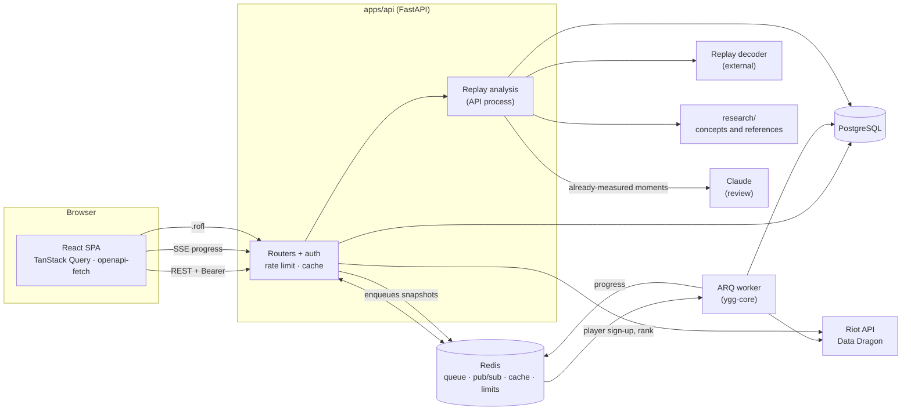
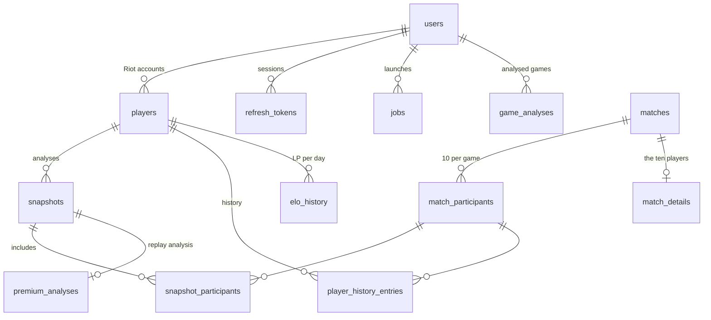

# YGG architecture

YGG is a monorepo with three pieces that share an analysis engine, plus a research folder from which the API takes the
concepts and references used by the game analysis.

```
packages/ygg-core   pure-Python analysis engine (Riot API, timeline, metrics, DuckDB, CLI)
apps/api            FastAPI API + ARQ worker + replay analysis (uses ygg-core and research/)
apps/web            React 19 + TypeScript client (types generated from the API's OpenAPI)
research            ladder harvest, win-probability model, coach concepts
infra               Dockerfiles, docker compose, nginx, Fly.io and dev.ps1
docs                this documentation
```

## Overview



## `packages/ygg-core`

No FastAPI or SQLAlchemy; it is tested without services (strict `mypy`, 201 tests).

- `riot/`: an `aiohttp` client with a **global sliding-window limiter** (per second and per two minutes) shared by all
  requests, a coordinated pause on a 429 and parsers tolerant of missing fields.
- `timeline/`: timeline enrichment (gold, CS and XP differences at 8, 14 and 25 minutes, deaths with coordinates,
  vision at objectives, *Role Quests*, map zones and per-role impact).
- `metrics/`: aggregates, a per-role normalised radar, semantic statuses (`excellent`/`good`/`normal`/`bad`), trends
  with a moving average, a game grade built from the timeline, and WPA (*win probability added*). `wpa_model.py` is
  generated by `research/ladder/export_wpa_model.py`.
- `store/duckdb_store.py` and `cli.py`: a local store and a command-line tool (ADR 0003).

## `apps/api`

| Layer | Where | Notes |
|---|---|---|
| Entry | `main.py`, `app/core/middleware.py` | Pure ASGI middlewares: request id, CORS, global limit, demo mode |
| Routes | `app/routers/` | `response_model` on all of them; `openapi.json` is versioned and checked in CI |
| Auth | `app/auth/` | 15-minute JWT + an opaque refresh token rotated in an httpOnly cookie (ADR 0006) |
| Services | `app/service/` | Bridge to ygg-core, dashboard and its cache, Data Dragon, rank cutoffs, replays and review |
| Jobs | `app/jobs/` | ARQ (or inline) queue, heartbeat, orphan recovery, progress in Redis (ADR 0004 and 0005) |
| Data | `app/db/`, `app/crud/`, `app/queries/*.sql` | Async SQLAlchemy 2.0, batch upserts and handwritten SQL (ADR 0002) |
| Schema | `alembic/versions/` | 24 migrations; Alembic is the only owner of the schema |

### Data model



One `match_participants` row per player and game, unique on `(match_id, puuid)` (ADR 0001). A Riot account is only
analysed if it is **verified**: the user puts the profile icon YGG asks for on their client and the API checks it on
Riot.

### The flow of a snapshot

1. `POST /snapshots/` validates the player's owner and the per-user limit. If a job with the same parameters is already
   active it returns that one (partial unique index); otherwise it creates the row in `jobs` and enqueues.
2. The worker marks `processing`, starts the heartbeat and calls `run_stats_extraction`: it lists the period's games,
   reuses the ones already stored **for that player** and downloads the rest (match and timeline) through the global
   limiter.
3. Every step of progress is published to Redis. `GET /snapshots/jobs/{id}/stream` forwards it over SSE to whoever is
   watching.
4. Matches and participants are upserted in batches, the snapshot is created and the cache of the affected dashboards is
   invalidated.
5. If the worker dies, the recovery cron marks the job as interrupted and the user can retry it.

### The flow of a game analysis

This is the core of the product. Since patch 16.20 Riot only lets you download the replays of games you took part in, so
the user downloads it from their own client and uploads it to the web app (`POST /games/{id}/replay`).

1. **Cheap checks before reading the file**: session, verified account, rate limit (12 uploads per hour), quota (per
   rolling 24 h; the quota is spent when the analysis comes out complete, not on upload), and the
   user's own and global uploads in progress.
2. **Bounded read**: it is cut off past 40 MB, also with `Transfer-Encoding: chunked`, and the `.rofl` structure and the
   memory it declares are validated.
3. **That it is that game and yours**: the game is requested from Riot with the user's account and it is checked that the
   ten Riot IDs in the file are Riot's and that one of the user's verified accounts played it.
4. **Decode** in separate processes with the decoder's Python (it uses the game's executables), with a deadline and one at
   a time. The replay is kept in a folder of its own for that upload and deleted when it finishes.
5. **Analyse**: the game's timeline goes through the `research/replays` engine (`features` and `coach`), which returns the
   player's feature row, their moments (minute, place, cost, text) and the WP curve; it is compared with the references
   for their league and role (`premium_reference.json`, 5,144 games).
6. **Review**: Claude receives what was already measured (it doesn't see the replay) and answers in JSON with a fixed
   schema. Without a key, or if the call fails, the analysis is stored anyway, without a review.
7. The web app polls every few seconds until `done` or `error`. If the API restarts midway, whatever was in `processing`
   comes out as failed, without spending quota, and can be uploaded again.

### Caching and protection

- A per-snapshot dashboard in Redis (`dashboard:v2:{id}`), invalidated when its games or notes change.
- Data Dragon data in Redis; images are requested straight from Riot's CDN.
- Sliding-window rate limiting in Redis: global per IP, login per IP and per email, sign-up, refresh, analyses and
  replay uploads per user. If Redis goes down, the protection degrades before the API does.
- `DEMO_MODE`: a read-only API that never calls Riot (see [`deploy.md`](deploy.md)).

### Observability

Structured JSON logs with a `request_id` (structlog), Prometheus metrics at `/metrics`, optional Sentry, `/health/live`
for the process and `/health` with Postgres and Redis (503 if either fails).

## `apps/web`

- **Routes** (React Router, one *chunk* per screen): `/login`, `/legal/:doc`, `/account`, `/analysis/:matchId`,
  `/players/:id/snapshots/:snapshotId`, `/players/:id/snapshots/compare?a=&b=`, `/cutoffs`, `/ranks` and
  `/admin/(stats|users|players)`. The tab, the champion filter and the comparison live in the URL. One Riot account per
  user: `/players` redirects to `/account`.
- **Data**: a typed `openapi-fetch` client with `src/lib/api/schema.d.ts`, generated from `apps/api/openapi.json` (CI
  fails if they drift). TanStack Query caches and invalidates by hierarchical keys (`src/lib/queryKeys.ts`).
- **Session**: in-memory access token, a silent refresh on a 401 with a single shared request.
- **Game analysis** (`features/games`): moments with their minute over the WP curve, a map with each one's place, coach
  cards that cite the moments by id, and a replay upload with a client-side pre-check.
- **Charts**: radar and trends with Recharts; a death heat map in hand-written SVG over the minimap; a games table with
  TanStack Table.
- **Accessibility**: visible focus, screen-reader descriptions on the charts and `prefers-reduced-motion`.

## Environments

| Environment | How | Notes |
|---|---|---|
| Full local | `make up` (docker compose) | Postgres, Redis, API, worker and web at `localhost:5173`. No replay analysis |
| Local without Docker | `uvicorn` with `REDIS_URL=memory://` + `npm run dev` | The job runs in the process itself (`InlineJobQueue`) |
| Local with replays | The above + `lol-replay-decoder` alongside and `requirements-replays.txt` | The author's PC: the decoder is not in this repository |
| CI | GitHub Actions | gitleaks, ruff, mypy, pytest (core and API with services), lint, tests, build, budget and web e2e |
| Production | Vercel + Fly.io + Supabase + Upstash (planned) | Not deployed; see [`deploy.md`](deploy.md) |
